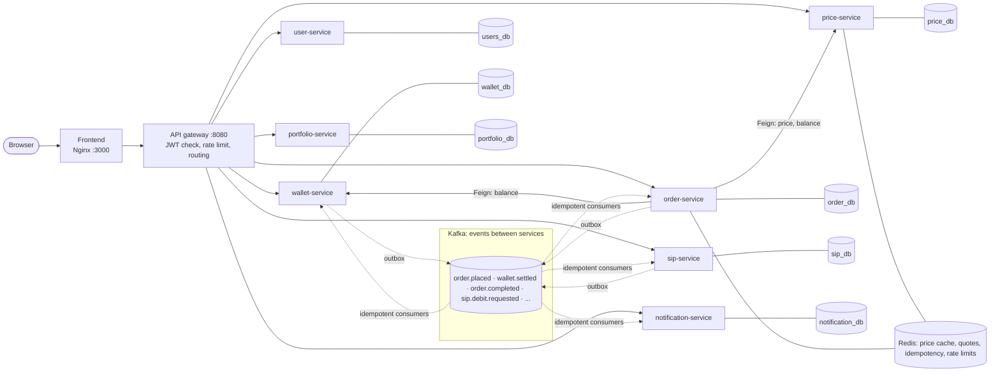
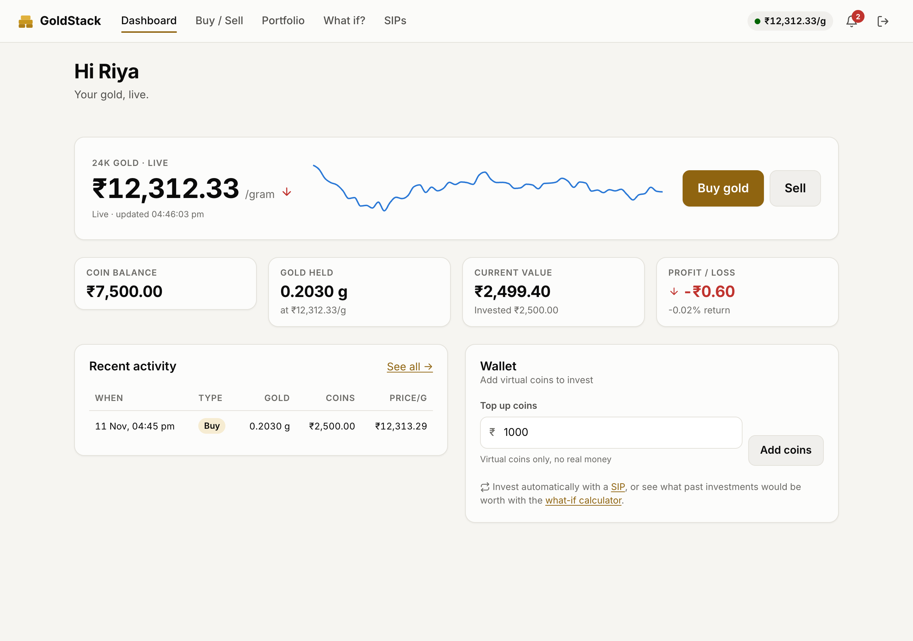
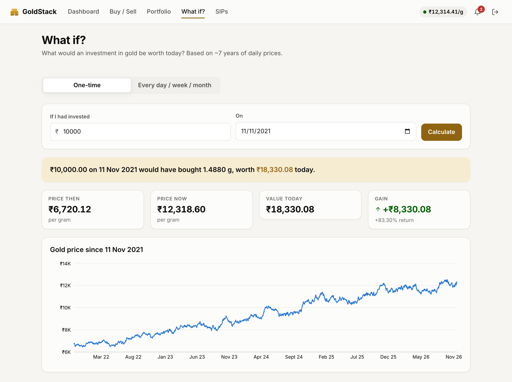

# GoldStack 🪙

GoldStack is a digital gold investment platform, similar to Jar, Paytm Gold and PhonePe Gold. Users buy and sell gold in grams with **virtual coins** (1 coin = ₹1, not real money). It also has a live gold price, SIPs (automatic recurring buys) and a "what if I had invested…" calculator.

It is built as a set of microservices, each with its own database, connected by Kafka events and a single API gateway. The project is a learning and portfolio piece, and it is built in phases (see [docs/SPEC.md](docs/SPEC.md)).

## Features
- Signup and login with JWT, a starting coin bonus, and a mock top-up
- Live gold price, streamed over WebSocket
- Buy and sell with a 5-minute locked quote, and safe retries with idempotency keys
- Portfolio: grams, invested amount, current value, P&L, return %, transaction history
- What-if calculator for a lump sum and for SIPs, with charts
- SIPs: create, pause, resume, cancel, installment history
- Notifications for purchases, SIP successes and SIP failures

## Architecture



Each service owns its database, so no service reads another service's tables. A buy runs as a saga: `order-service` asks the wallet to debit coins, then credits the gold, and undoes the debit (a refund) if the gold step fails. Full sequence diagrams of every success and failure path are in **[docs/FLOWS.md](docs/FLOWS.md)**, and the service-by-service design is in **[docs/ARCHITECTURE.md](docs/ARCHITECTURE.md)**.

## Tech stack

| Area | Technologies |
|---|---|
| Backend | Java 21, Spring Boot 3.5, Spring Cloud Gateway, OpenFeign, Resilience4j, ShedLock, springdoc (Swagger UI) |
| Data | PostgreSQL 16 (one database per service), Flyway migrations, Redis 7 |
| Messaging | Apache Kafka 4 (KRaft), transactional outbox, idempotent consumers |
| Frontend | React 19, TypeScript, Vite, classic Redux with redux-saga, Recharts, SCSS modules |
| Testing | JUnit 5, Testcontainers (real Postgres, Redis and Kafka), Vitest, ESLint |
| Delivery | Docker (multi-stage images), docker compose, Kubernetes (kind), GitHub Actions |
| Observability | Micrometer, Prometheus, Grafana (dashboard committed as JSON), Zipkin tracing, Kafka UI |

## Run it in one command

You need Docker (Docker Desktop, or Colima on macOS). Then:

```bash
cp .env.example .env     # set DB_PASSWORD, REDIS_PASSWORD and JWT_SECRET (openssl rand -base64 32)
docker compose up --build -d
```

The first build takes several minutes. Then open the app and the tools:

| URL | What |
|---|---|
| http://localhost:3000 | The app |
| http://localhost:8080 | API gateway: the single public API |
| http://localhost:8089 | Kafka UI: topics, messages, consumer groups and lag |
| http://localhost:3001 | Grafana (user `admin`, password from `GRAFANA_PASSWORD`, default `admin`). The GoldStack dashboard is preloaded |
| http://localhost:9090 | Prometheus: scrape targets and alert rules |
| http://localhost:9411 | Zipkin: distributed traces across services |
| `localhost:8081`…`8087` `/swagger-ui.html` | Swagger UI for each service |
| `localhost:5433` | PostgreSQL (see [Inspecting the database](#inspecting-the-database-pgadmin)) |
| `localhost:6380` | Redis (see [Inspecting Redis](#inspecting-redis-redis-cli)) |

Stop it with `docker compose down` (data is kept) or `docker compose down -v` (also wipes the database).

Watch a saga: open Kafka UI, go to *Topics* and open `order.placed`, buy gold in the app, and watch `order.placed → wallet.settled → order.completed` appear. To see a **compensation** (refund) instead, run this first:
```bash
curl -X POST localhost:8080/api/dev/saga/fail-next-gold-credit -H "Authorization: Bearer <token>"
```

### Other ways to run it
- **Kubernetes (kind):** the same system as nine Deployments with probes, an ingress, an autoscaler and a ShedLock demo. See **[infra/k8s/README.md](infra/k8s/README.md)**.
- **Development mode:** run the frontend with hot reload (`cd frontend && npm install && npm run dev`, then http://localhost:5173), or run one service from Maven while the rest run in Docker. See the notes below.

Prerequisites for development mode: Java 21 (`export JAVA_HOME=/opt/homebrew/opt/openjdk@21` on macOS with Homebrew), Maven 3.9+, Node 22+.

```bash
docker compose stop wallet-service
cd backend && mvn -q -pl wallet-service -am spring-boot:run
```
(Locally the services use ports 8081–8087. The Docker gateway still points at the containers, so call a locally running service directly, e.g. `localhost:8082/swagger-ui.html`.)

## API documentation

- **Swagger UI:** each service serves its own OpenAPI page, listed in the table above.
- **Postman:** [docs/postman/GoldStack.postman_collection.json](docs/postman/GoldStack.postman_collection.json) has all 34 requests, grouped by feature. Import it, then run **Sign up** or **Log in** first: they save the token for the other requests. Buy and sell also save the quote and order ids.
- **Route list:** the table in [API routes](#api-routes) below.

## Screenshots

**Live price and dashboard**



**What-if calculator**



## Repository layout
| Folder      | What's inside                                  |
|-------------|------------------------------------------------|
| `backend/`  | 8 Spring Boot services + 2 shared libraries (multi-module Maven) |
| `frontend/` | React + TypeScript + Vite web app              |
| `infra/`    | docker compose config, Kubernetes manifests, Prometheus and Grafana config |
| `docs/`     | Spec, architecture, flows, Postman collection, screenshots |
| `.github/`  | GitHub Actions CI workflow                     |
| `archive/`  | The Phase 1–4 monolith, kept for comparison    |

## Progress
- [x] Phase 0: Setup
- [x] Phase 1: Modular monolith (backend logic)
- [x] Phase 2: React frontend
- [x] Phase 3: Docker
- [x] Phase 4: Redis
- [x] Phase 5: Microservices + Kafka
- [x] Phase 6: Observability (Prometheus, Grafana, Zipkin) + integration tests with Kafka
- [x] Phase 7: Kubernetes
- [x] Phase 8: CI/CD + polish

## Development notes

### Frontend
Frontend architecture (classic Redux with redux-saga, the design system, error handling, and how to add a feature) is in **[frontend/README.md](frontend/README.md)**.

| Page | What it shows |
|---|---|
| Dashboard | Live price and sparkline (WebSocket), coin balance, gold, value, P&L, recent activity, top-up |
| Buy / Sell | Quote with a 5-minute countdown, then confirm. One idempotency key per attempt, safe retry, expired-quote and low-balance handling |
| Portfolio | Summary, value-vs-invested chart, paginated transactions |
| What if? | Lump-sum and SIP calculators with charts and table views |
| SIPs | Create, pause, resume, cancel, installment history, and a dev-only "run SIP job now" button (`npm run dev` only) |
| Notifications | Alerts for purchases, SIP successes and failures |

Money note: the API sends coins, grams and prices as **strings** (`"500.00"`), because JavaScript numbers are doubles. The frontend only formats them for display and never does arithmetic on money.

### Inspecting the database (pgAdmin)
Postgres is published on your Mac at port **5433** (not the default 5432, so it can't clash with a
locally installed Postgres), and any database tool can connect.
In **pgAdmin**: right-click **Servers → Register → Server…**
- **General** tab → Name: `GoldStack (local)`
- **Connection** tab → Host: `127.0.0.1` · Port: `5433` · Maintenance database: `goldstack` · Username: `goldstack` · Password: the `DB_PASSWORD` value from your `.env`

Then open **Databases → goldstack → Schemas → public → Tables**, or use **Tools → Query Tool**. Some queries to try:
```sql
-- Every coin movement, newest first (each one has a DEBIT + CREDIT pair)
SELECT transaction_id, direction, amount, entry_type, created_at
FROM coin_ledger_entries ORDER BY created_at DESC LIMIT 20;

-- The double-entry promise: both of these must be exactly 0
SELECT SUM(balance) FROM wallets;
SELECT SUM(grams)   FROM gold_accounts;
```
No pgAdmin? `docker compose exec postgres psql -U goldstack goldstack` opens a SQL prompt inside the container.

### Inspecting Redis (`redis-cli`)
```bash
docker compose exec redis redis-cli        # already authenticated
```
Then try `SCAN 0 COUNT 100`, `GET gold:price:latest`, `TTL quote:<id>` or `MONITOR`.
What each key is for, and more commands: **[docs/REDIS.md](docs/REDIS.md)**.

### Running the tests
Integration tests start a real PostgreSQL, Redis and Kafka with Testcontainers, so Docker must be running.
With **Colima**, Testcontainers needs to be told where Docker is:
```bash
export DOCKER_HOST="unix://$HOME/.colima/default/docker.sock"
export TESTCONTAINERS_DOCKER_SOCKET_OVERRIDE=/var/run/docker.sock
cd backend && mvn verify                         # all modules
cd backend && mvn -pl order-service -am test     # one service
cd frontend && npm test                          # frontend unit tests
```

| Test (module) | What it proves |
|---|---|
| `MoneyTest` (common) | Rounding rules: grams DOWN, payouts DOWN, why not `double` |
| `CoinLedgerTest` (wallet) | Every transfer writes one DEBIT + one equal CREDIT; user wallets can't go negative |
| `WalletSagaStepTest` (wallet, Postgres) | Two simultaneous settlements can't overspend; a redelivered event is processed once; a refund (compensation) pays exactly once |
| `LedgerReconcilerTest` (wallet, Postgres) | A healthy ledger reconciles to zero; a balance changed outside the ledger is caught and raises the imbalance gauge |
| `QuoteTest` (order) | Quotes expire after 5 minutes; a BUY quote can't sell |
| `OrderSagaTest` (order, Postgres + Redis) | Buy saga to COMPLETED; same key ×5 at once = one order; gold-credit failure asks for a refund; failed sell payout returns the gold; duplicate replies ignored |
| `OrderSagaKafkaTest` (order, Postgres + Redis + **Kafka**) | The buy saga over a real broker: `wallet.settled` in gives COMPLETED and `order.completed` comes out on the topic; the failure path does the same with `order.failed` |
| `SipFlowKafkaTest` (sip, Postgres + **Kafka**) | A due SIP is requested over Kafka, its success or failure comes back and is recorded, and a second run the same day requests nothing |
| `WhatIfCalculatorTest`, `AverageCostTest` (portfolio) | What-if maths and average-cost P&L against hand-calculated numbers |

These run on every push in GitHub Actions (see below).

## Continuous integration and delivery
The workflow in **[.github/workflows/ci.yml](.github/workflows/ci.yml)** runs on every push and pull request:

| Job | What it does |
|---|---|
| `backend-tests` | `mvn verify` for all modules, including the Testcontainers tests |
| `frontend` | ESLint, unit tests and the production build |
| `images` | Builds the Docker image of each of the 8 services (matrix) |
| `frontend-image` | Builds the frontend image |
| `manifests` | Validates `docker-compose.yml` and the Kubernetes manifests |

Images are built but not pushed yet. Pushing to a registry is the next step if you deploy to a real cluster.

## Observability
- **Metrics:** every service exposes `/actuator/prometheus`. Prometheus scrapes all eight, and the alert rules are in [infra/observability/alerts.yml](infra/observability/alerts.yml).
- **Ledger health:** the reconciliation job in wallet-service checks the coin ledger every 5 minutes and publishes `goldstack_ledger_imbalance`. The `CoinLedgerOutOfBalance` alert fires if it is above 0.
- **Dashboard:** the Grafana dashboard (requests per second, p95 latency, JVM heap, ledger imbalance) is in [infra/observability/grafana/dashboards](infra/observability/grafana/dashboards).
- **Tracing:** every request is traced across the services and shown in Zipkin.

## API routes

All routes except the public ones need `Authorization: Bearer <token>`. Errors always use one JSON shape:
`{timestamp, status, error, message, path, fieldErrors}`.

| Method | Path | Auth | Description |
|---|---|---|---|
| POST | `/api/auth/signup` | public | Create an account (+10,000 bonus coins) and get a JWT |
| POST | `/api/auth/login` | public | Log in and get a JWT |
| GET | `/api/users/me` | ✅ | My profile |
| GET | `/api/wallet` | ✅ | Coin balance |
| POST | `/api/wallet/topup` | ✅ | Mock top-up `{amount}` (max 100,000 per call) |
| GET | `/api/wallet/ledger?page&size` | ✅ | My coin ledger entries |
| GET | `/api/prices/latest` | public | Current live price per gram |
| GET | `/api/prices/daily?from&to` | public | Daily closing prices |
| GET | `/api/prices/ticks?limit` | public | Recent live ticks |
| WS | `/ws/price` | public | Live price push |
| POST | `/api/orders/quotes` | ✅ | Lock a price for 5 min: `{side:"BUY", coins}` or `{side:"SELL", grams}` |
| POST | `/api/orders/buy` | ✅ | `{quoteId}` + header `Idempotency-Key`. 201 done, 200 replay, **202 still processing**, 422 failed |
| POST | `/api/orders/sell` | ✅ | `{quoteId}` + header `Idempotency-Key` |
| GET | `/api/orders?page&size` | ✅ | My orders |
| GET | `/api/orders/{id}` | ✅ | One order (poll after a 202: `PENDING` → `COMPLETED` / `FAILED`) |
| GET | `/api/gold` | ✅ | My gold balance (grams) |
| GET | `/api/gold/ledger?page&size` | ✅ | My gold ledger entries |
| GET | `/api/portfolio` | ✅ | Grams, invested, value, P&L, return %, coins |
| GET | `/api/portfolio/transactions?page&size` | ✅ | Transaction history |
| GET | `/api/portfolio/history` | ✅ | Daily value vs invested (chart data) |
| GET | `/api/what-if/lump-sum?amount&date` | public | "If I had invested X on date D…" |
| GET | `/api/what-if/sip?amount&frequency&startDate` | public | SIP what-if with a time series |
| POST | `/api/sips` | ✅ | Create SIP `{amount, frequency, startDate}` |
| GET | `/api/sips` | ✅ | My SIPs |
| GET | `/api/sips/{id}` | ✅ | One SIP |
| POST | `/api/sips/{id}/pause` · `/resume` · `/cancel` | ✅ | Change SIP status |
| GET | `/api/sips/{id}/executions` | ✅ | Installment history (success/failed) |
| GET | `/api/notifications?page&size` | ✅ | My notifications |
| GET | `/api/notifications/unread-count` | ✅ | Unread count |
| POST | `/api/notifications/{id}/read` · `/read-all` | ✅ | Mark read |
| POST | `/api/dev/sips/run?date` | ✅ dev only | Request today's SIP installments now (results arrive via Kafka) |
| GET | `/api/dev/ledger/coins` · `/api/dev/ledger/gold` | ✅ dev only | Check each ledger balances to 0 |
| POST | `/api/dev/saga/fail-next-gold-credit` | ✅ dev only | Make the next buy fail after the debit, to watch the refund compensation |

| Status | Meaning |
|---|---|
| 400 | Validation failed / bad input |
| 401 | Missing or invalid token |
| 404 | Not found (or not yours) |
| 409 | Conflict (email taken, idempotency key reused with a different quote, identical request still in progress, invalid SIP state) |
| 410 | Quote expired or already used |
| 422 | Insufficient coins or gold |
| 429 | Rate limit exceeded (see `Retry-After` header) |
| 503 | Redis or another service unavailable (`SERVICE_UNAVAILABLE` / `DEPENDENCY_UNAVAILABLE`) |

## Design decisions

**Why microservices instead of one app?** Each service can be deployed, scaled and failed on its own. The
cost is more moving parts, so this project keeps every service small and explains each boundary. The phase-1
monolith in `archive/` shows the same business logic in one application for comparison.

**Why one database per service?** Services never read each other's tables, so their schemas can change
independently. The price is that data is copied through events, and that is why Kafka matters here.

**Why Kafka?** Services talk through events instead of calling each other for every step, so a slow or
restarting service does not block the others. Events are kept on the topic, so a consumer that was down can
catch up. Kafka UI makes the flow visible, which helps learning and debugging.

**Why a saga, and why orchestrated?** A buy touches two services (coins and gold), and there is no single
database transaction across them. `order-service` acts as the conductor: it asks the wallet to debit, then
credits the gold, and if the gold step fails it asks for a refund. An orchestrator keeps the whole sequence in
one class, which is easier to read and test than choreography, where each service reacts to the others'
events.

**Why the transactional outbox?** Writing to the database and publishing to Kafka are two separate actions. If
the app crashes between them, the event is lost or the database change is lost. The outbox writes the event
into the same database transaction as the business change, and a relay publishes it afterwards. Either both
happen or neither does.

**Why idempotency everywhere?** Networks retry requests and Kafka can deliver a message twice. A buy carries an
`Idempotency-Key` header, so a retry returns the same order instead of buying twice. Consumers record the ids
of the events they handled, so a redelivered event is skipped. The same key sent five times at once creates
one order (there is a test for it).

**Why Redis?** It holds the things that are fast, short-lived or safe to lose: the live price cache, the
5-minute quotes (with a TTL, so they expire on their own), idempotency keys, the rate limiter, and the what-if
cache. Postgres stays the source of truth, so a Redis restart loses speed, not money.

**Why a double-entry ledger, and why `BigDecimal`?** Every coin movement writes a DEBIT and an equal CREDIT, so
the totals must always cancel out. The reconciliation job checks this and raises an alarm. Money is
`BigDecimal` with an explicit rounding mode, because `double` cannot represent `0.1` exactly. The JSON API sends
money as strings for the same reason, since JavaScript numbers are doubles too.

**Why ShedLock on scheduled jobs?** With several replicas, every pod would run the daily SIP job. ShedLock
stores a lock in the database, so only one pod runs each run. The Kubernetes guide has a demo of this.

**Why a gateway that checks the JWT?** Requests without a valid token never reach a service. The services check
the token again (defence in depth), in case someone calls them directly inside the cluster.

**Why keep the monolith?** `archive/` holds the phase 1–4 monolith. It is not built, but it shows how the same
features were first written in one codebase, which makes the trade-offs above easier to see.

## Learn more
- [docs/SPEC.md](docs/SPEC.md): the full specification and phase plan
- [docs/ARCHITECTURE.md](docs/ARCHITECTURE.md): service-by-service design
- [docs/FLOWS.md](docs/FLOWS.md): sequence diagrams of the buy, sell and SIP flows
- [docs/DATA-MODEL.md](docs/DATA-MODEL.md) and [docs/REDIS.md](docs/REDIS.md): the data model and every Redis key
- [infra/k8s/README.md](infra/k8s/README.md): running on Kubernetes, with the demos and troubleshooting
