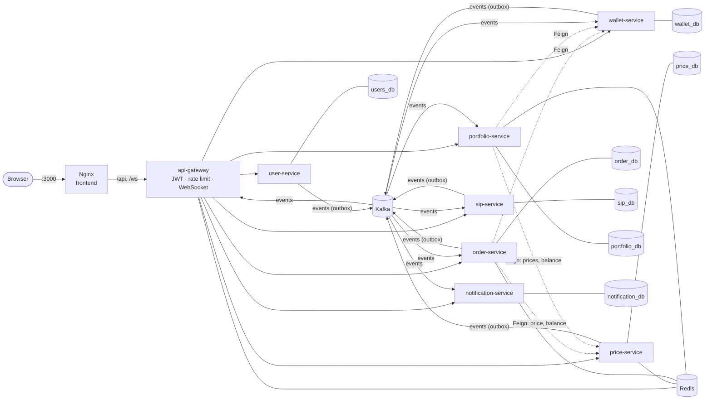

# GoldStack architecture (Phase 5: microservices)

The Phase 1–4 monolith (kept in `archive/phase4-monolith/`) was split into **eight services**. Each one owns its
own PostgreSQL database. They talk to each other over **HTTP (OpenFeign)** when they need an answer right now, and
over **Kafka events** for everything that "happened".



## Services

| Service | Port (local) | Owns | Responsibility |
|---|---|---|---|
| api-gateway | 8080 | – | The only public entry point: routing, JWT check, rate limiting (`ratelimit:*` in Redis), live-price WebSocket |
| user-service | 8081 | `users_db`: users, outbox | Signup, login, profile. Publishes `user.registered` |
| wallet-service | 8082 | `wallet_db`: wallets, coin_ledger_entries, outbox, processed_events | Coin balances + double-entry ledger. Saga participant: settles orders, refunds |
| price-service | 8083 | `price_db`: price_history, daily_prices, shedlock | Price ticker (ShedLock), history, `gold:price:latest` in Redis, publishes `gold.price.updated`. Circuit breaker around the real API |
| order-service | 8084 | `order_db`: orders, gold_accounts, gold_ledger_entries, outbox, processed_events | Quotes (`quote:*`), idempotency (`idem:*`), gold holdings, **saga orchestrator** |
| sip-service | 8085 | `sip_db`: sips, sip_executions, shedlock, outbox, processed_events | SIP plans, daily job (ShedLock) requesting each installment |
| portfolio-service | 8086 | `portfolio_db`: portfolio_positions, portfolio_transactions, processed_events | **Read model** built from `order.completed`: P&L, history, what-if (`whatif:*` cache) |
| notification-service | 8087 | `notification_db`: notifications, processed_events | Turns events into user messages |

Shared code lives in two libraries:
- **`common`**: plain Java with no web stack, so the reactive gateway can use it too. It holds the money rules, error
  types, `JwtService` and the **event contracts** (`Topics`, `Events`).
- **`common-web`**: Spring auto-configuration that every servlet service picks up automatically. It provides JWT
  security, the JSON error format, BigDecimal-as-string, the outbox writer and relay, idempotent consumers, Feign error
  decoding, dead-letter topics, and creates the topics.

## Kafka topics

| Topic | Producer | Consumers |
|---|---|---|
| `gold.price.updated` | price | portfolio, gateway (WebSocket push) |
| `user.registered` ➕ | user | wallet (signup bonus), notification (welcome) |
| `order.placed` | order | wallet |
| `wallet.settled` ➕ | wallet | order |
| `wallet.settlement.failed` ➕ | wallet | order |
| `order.completed` | order | portfolio, notification, sip ➕ |
| `order.failed` | order | wallet (refund), notification |
| `sip.debit.requested` | sip | order |
| `sip.debit.failed` | order | sip, notification |
| `notification.send` | any (wallet: top-ups) | notification |

➕ = added to the spec's table:
- **`user.registered`**: in the monolith, signup created the wallet in the same transaction. Across databases
  that's impossible, so user-service announces the signup, and the wallet gives the bonus when it hears about it.
- **`wallet.settled` / `wallet.settlement.failed`**: an orchestrated saga needs **replies**. order-service asks the
  wallet (via `order.placed`) and must hear back before it credits gold or gives up.
- **sip consumes `order.completed`**: that's how a SIP installment learns it succeeded.

Each failing message is retried 3 times, then sent to `<topic>.DLT` (dead letter topic), so one bad message can't
block the topic.

## The patterns, and why each one is needed

### Database per service
Each service connects only to its own database. There are no foreign keys or joins across services, so a service can
change its tables without breaking anyone else. The price is that no single database transaction can span two
services any more. That is the problem the next three patterns solve.

### Saga (orchestrated) with compensation
A buy used to be one transaction: coins out, gold in. Now coins are in `wallet_db` and gold is in `order_db`.
A **saga** is a chain of local transactions. If a later step fails, a **compensating** step undoes the earlier ones:

| Step | Buy | Sell |
|---|---|---|
| 1 | wallet debits coins | order takes the gold (local) |
| 2 | order credits gold | wallet pays out coins |
| Compensation if step 2 fails | wallet **refunds** the coins | order **returns** the gold |

`OrderSaga` (order-service) is the **orchestrator**: one place decides what happens next. See
[FLOWS.md](FLOWS.md) for every path as a sequence diagram. To watch a compensation live:
`POST /api/dev/saga/fail-next-gold-credit`, then buy something.

### Transactional Outbox
"Save to the database, then publish to Kafka" can fail halfway: the coins are gone, but nobody hears about it. So
events are **inserted into an `outbox` table in the same transaction** as the business change, and `OutboxRelay`
copies committed rows to Kafka. The event is published **if and only if** the change committed, at least once, and
never lost. Price ticks are the deliberate exception: a lost tick is harmless, so they're sent directly.

### Idempotent consumers
Kafka delivers **at least once**, so duplicates happen. Each consumer records event ids in `processed_events`, in the
same transaction as its work, and skips any id it has seen. On top of that, the saga only moves `PENDING` orders, the
wallet checks its ledger before refunding, and SIP orders use the key `sip:{sipId}:{date}`.

### ShedLock
With 3 instances of sip-service, the 09:00 job would fire 3 times. ShedLock stores a lock row in the `shedlock` table,
and only the instance holding the lock runs the job. The price ticker uses it too, so only one instance ticks.

### OpenFeign + Resilience4j
Synchronous calls are written as annotated interfaces (`Clients.java`), with 2–3 s timeouts so a slow service can't
hang a request. Remote errors are decoded back into normal `ApiException`s, and an unreachable service becomes 503.
price-service wraps the real gold API in a **circuit breaker**: after repeated failures it stops calling the API for
60 s and keeps serving the last price.

### API gateway
One public address, with JWT checks and rate limiting in a single place. `/internal/**` is never routed, so the
service-to-service endpoints stay private. Services still verify JWTs themselves (defence in depth). The WebSocket
lives here because every gateway instance consumes `gold.price.updated` in its own consumer group, so every browser
gets every tick, whichever instance it is connected to.

## Consistency: what changed for the user
The monolith was **strongly consistent**: everything was true the instant a request returned. Microservices are
**eventually consistent**, so some things arrive a few hundred milliseconds later:
- the signup bonus (`user.registered` → wallet)
- portfolio totals (`order.completed` → portfolio)
- notifications and SIP results

`POST /api/orders/buy` waits up to 5 s for the saga, so it normally still answers with the final result (201 or 422).
Under load it returns **202 Accepted**, and the frontend polls `GET /api/orders/{id}`.

## Running and watching it
```bash
docker compose up --build -d
```
- App: http://localhost:3000
- **Kafka UI: http://localhost:8089**. Open *Topics → order.placed → Messages*, buy gold in the app, and watch
  `order.placed → wallet.settled → order.completed` appear. *Consumers* shows each service's group and its lag.
- Swagger per service: `http://localhost:808{1..7}/swagger-ui.html`
- Gateway routes: http://localhost:8080/actuator/gateway/routes
