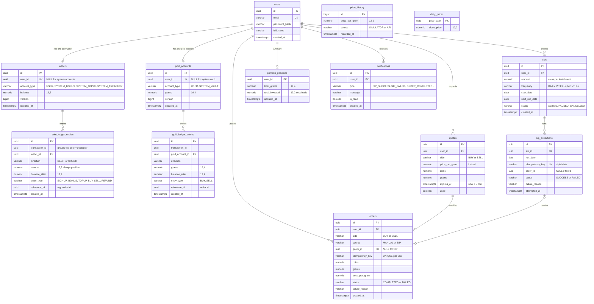

# GoldStack: Data Model (Phase 1, modular monolith)

This document describes every table in Phase 1, why it exists and how the double-entry ledger works.
Everything lives in **one PostgreSQL database**, but each table belongs to exactly one **module**. In Phase 5 each module becomes its own service with its own database. That is why modules never join across each other's tables.

---

## 1. Modules and the tables they own

| Module (Java package) | Tables                                   | Future service        |
|-----------------------|------------------------------------------|-----------------------|
| `user`                | `users`                                  | user-service          |
| `wallet`              | `wallets`, `coin_ledger_entries`         | wallet-service        |
| `price`               | `price_history`, `daily_prices`          | price-service         |
| `order`               | `quotes`, `orders`, `gold_accounts`, `gold_ledger_entries` | order-service |
| `sip`                 | `sips`, `sip_executions`                 | sip-service           |
| `portfolio`           | `portfolio_positions` (read model)       | portfolio-service     |
| `notification`        | `notifications`                          | notification-service  |

**Modules talk to each other** in two ways. These map one-to-one onto Phase 5:
- **A direct Java method call on another module's public service class** when an answer is needed now (e.g. order asks price "what's the price?"). This becomes **OpenFeign REST** later.
- **Spring `ApplicationEvent`s** for "something happened" (e.g. `OrderCompletedEvent`). This becomes **Kafka** later.

---

## 2. Number precision (SPEC §3)

| Kind of number | Java type    | Postgres type   | Scale | Rounding when computed            |
|----------------|--------------|-----------------|-------|-----------------------------------|
| Coins          | `BigDecimal` | `NUMERIC(19,2)` | 2     | `HALF_UP` for display/reports     |
| Grams          | `BigDecimal` | `NUMERIC(19,4)` | 4     | **`DOWN`** when converting coins→grams |
| Price per gram | `BigDecimal` | `NUMERIC(12,2)` | 2     | `HALF_UP`                         |
| Percentages    | `BigDecimal` | (not stored)    | 2     | `HALF_UP`                         |

**Why `DOWN` for grams?** ₹500 at ₹7,500/g is 0.066666… g. If we rounded *up* to 0.0667 g, the platform would hand out gold nobody paid for. Across millions of trades that adds up. Rounding down to 0.0666 g means gold is never created from nothing. Real apps behave the same way.

**Why not `double`?** `0.1 + 0.2` in a `double` is `0.30000000000000004`. With money, that tiny error compounds and the ledger stops reconciling. `BigDecimal` stores exact decimal digits.

---

## 3. Entity-relationship diagram



### Why each table exists

- **users**: login identity. Passwords are stored as a **BCrypt hash**, never as plain text, so even a database leak doesn't reveal them.
- **wallets**: one row per account holding coins. Users have one, and the platform has a few **system accounts** (explained in §4). `balance` is a *cached* total. The ledger is the truth, and the balance exists so we don't have to sum thousands of entries on every request.
- **coin_ledger_entries**: the append-only history of every coin movement. It is never updated and never deleted.
- **gold_accounts / gold_ledger_entries**: the same idea for grams of gold.
- **price_history**: every live tick (every ~5 s). It is used for the live chart and audit.
- **daily_prices**: one closing price per day for ~7 years, seeded at startup. The what-if calculator needs "price on date D", and scanning millions of ticks for that would be slow and pointless. The scheduler also writes today's close here.
- **quotes**: a locked price that is valid for 5 minutes. It was in Postgres for Phase 1. **Since Phase 4 it lives in Redis** (`quote:{id}`, TTL 5 min) and the table was dropped (V7). See [REDIS.md](REDIS.md).
- **orders**: one row per buy/sell. The `UNIQUE(user_id, idempotency_key)` constraint is the database-level guarantee that the same request can't execute twice.
- **sips / sip_executions**: the SIP plan, plus one row per attempted installment. `idempotency_key = sipId:date` is UNIQUE, so even if the scheduler runs twice on the same day, the second insert fails and nothing is bought twice.
- **portfolio_positions**: a **read model**. It is a pre-computed summary (grams + amount invested) that the portfolio module updates whenever it hears an `OrderCompletedEvent`. Phase 5's portfolio-service builds exactly this from Kafka events, so we're practising the pattern early.
- **notifications**: in-app alerts (e.g. "SIP failed: insufficient coins").

---

## 4. The double-entry ledger

### The idea in one sentence
**Coins and gold are never created or destroyed. They only move from one account to another, and every move is written twice: once as a DEBIT (leaving) and once as a CREDIT (arriving).**

The simpler alternative is a single-entry system: just doing `UPDATE wallets SET balance = balance - 500`. If a bug, crash or race condition corrupts that number, there's no way to tell what it *should* be. With double entry:
1. **Every balance can be rebuilt** by replaying its entries (`SUM(credits) − SUM(debits)`).
2. **Every transaction must balance.** Debits = credits within each `transaction_id`. A single SQL query can check this.
3. **The whole system sums to zero.** If the sum of all wallet balances (users + system) isn't exactly 0, something is wrong, and we know about it immediately. The Phase 6 reconciliation job checks exactly this.

### Our convention
- **CREDIT = balance goes up, DEBIT = balance goes down**, for every account. This matches how a bank SMS reads ("your account was credited").
- `amount` is always positive. The `direction` column says which way it moves.

### System accounts (where coins and gold "come from")
If coins only move between accounts, where does a signup bonus come from? It comes from a **system account** that is allowed to go negative. Its negative balance records how many coins the platform has issued.

| Asset | System account     | Goes negative when…                 | Meaning                         |
|-------|--------------------|-------------------------------------|---------------------------------|
| COIN  | `SYSTEM_BONUS`     | signup bonuses are given            | total bonus coins issued        |
| COIN  | `SYSTEM_TOPUP`     | users top up                        | total top-up coins issued       |
| COIN  | `SYSTEM_TREASURY`  | (goes **positive** when users buy gold) | coins the platform received for gold |
| GOLD  | `SYSTEM_VAULT`     | users buy gold                      | total grams sold to users       |

User accounts can **never** go negative. That is enforced in code (with a row lock) and by a database `CHECK` constraint as a last line of defence.

### Worked example
Price is ₹7,500/g. Asha signs up, tops up, buys, then sells.

**1. Signup bonus of 1,000 coins** (`transaction_id = T1`)

| wallet        | direction | amount | balance_after |
|---------------|-----------|-------:|--------------:|
| SYSTEM_BONUS  | DEBIT     | 1000.00 | −1000.00     |
| Asha          | CREDIT    | 1000.00 | 1000.00      |

Debits 1000 = Credits 1000 ✅

**2. Buys ₹500 of gold** at the locked quote price ₹7,500/g
grams = 500 / 7500 = 0.066666… → **0.0666 g** (RoundingMode.DOWN)

This writes **two** balanced transactions inside **one database transaction** (either both happen, or neither does):

Coin ledger (`T2`):

| wallet          | direction | amount | balance_after |
|-----------------|-----------|-------:|--------------:|
| Asha            | DEBIT     | 500.00 | 500.00        |
| SYSTEM_TREASURY | CREDIT    | 500.00 | 500.00        |

Gold ledger (`T3`):

| gold_account  | direction | grams  | balance_after |
|---------------|-----------|-------:|--------------:|
| SYSTEM_VAULT  | DEBIT     | 0.0666 | −0.0666       |
| Asha          | CREDIT    | 0.0666 | 0.0666        |

**3. Price rises to ₹8,000/g. She sells 0.0300 g**
coins = 0.0300 × 8000 = **240.00**

Gold: Asha DEBIT 0.0300, SYSTEM_VAULT CREDIT 0.0300
Coins: SYSTEM_TREASURY DEBIT 240.00, Asha CREDIT 240.00

**Check the sums (the reconciliation test):**
- Coins: Bonus −1000 + Treasury (500 − 240 = 260) + Asha (1000 − 500 + 240 = 740) = **0** ✅
- Gold: Vault (−0.0666 + 0.0300 = −0.0366) + Asha 0.0366 = **0** ✅

---

## 5. Preventing double spending (concurrency)

The problem: Asha has 500 coins and taps "Buy ₹500" on two phones at the same moment. Without protection:
1. Request A reads balance 500 → "enough!"
2. Request B reads balance 500 → "enough!"
3. Both debit. Balance = −500. 💥

**Our fix is a pessimistic row lock.** Inside the buy transaction we load the wallet with `SELECT … FOR UPDATE`. The second request **waits** at that line until the first commits, then reads the *new* balance (0) and is rejected with `422 INSUFFICIENT_BALANCE`.
We pick pessimistic locking over optimistic (`@Version` + retry) because a buy is a short, high-contention operation on a single row. Waiting a few milliseconds is simpler and gives a clearer error than retrying. We still keep a `version` column so JPA can catch any accidental lost update.

A **concurrency test** will fire two buys at the same time from two threads and assert that exactly one succeeds and the balance never goes below 0.

---

## 6. Idempotency (nothing executes twice)

The problem: the user taps "Buy", the network drops before the response arrives, and the app retries. Without protection the user buys twice.

- The client sends an `Idempotency-Key` header (a random UUID per buy attempt).
- `orders` has `UNIQUE(user_id, idempotency_key)`.
- If the key has been seen before, we **return the original order's result** with no second debit.
- If the same key arrives with a *different* request body, we return `409 CONFLICT`, because that's a client bug.
- SIPs use the key `sipId:yyyy-MM-dd`, enforced by the UNIQUE constraint on `sip_executions`.

(In Phase 4, Redis `idem:{key}` adds a fast cache in front of this, but the database constraint stays as the final guarantee.)

---

## 7. Key behaviours decided for Phase 1

| Topic | Decision | Why |
|---|---|---|
| Signup bonus | 10,000 coins | Enough to play with straight away |
| Top-up | mock endpoint, max 100,000 coins per call | No real payments |
| Buy input | user enters **coins** ("buy ₹500 worth") | How Jar/Paytm Gold work |
| Sell input | user enters **grams** | You sell gold you own |
| Pricing | one price per gram for buy and sell (no spread or GST) | Keeps the maths clear. A spread can be added later |
| Quote | 5 minutes, single use, belongs to one user | Stops replaying old cheap quotes |
| Live price | simulator ticks every 5 s (random walk) | Works offline. The real-API adapter is pluggable |
| Historical seed | ~7 years of daily prices from a seeded simulator (deterministic, so results are repeatable) | What-if works out of the box |
| SIP schedule | `@Scheduled` once a day + a dev-only "run now" endpoint for testing | So you don't wait a day to test |
| SIP failure | execution marked `FAILED`, user notified, `next_run_date` moves to the next cycle (that installment is skipped) | "Retry next cycle" |
| Portfolio "invested" | **average cost** method: selling reduces invested proportionally | Standard, and what users expect |
| IDs | UUID | Safe to expose in URLs, and can't be guessed |

---

## 8. Error format (all endpoints)

```json
{
  "timestamp": "2026-11-03T10:15:30Z",
  "status": 422,
  "error": "INSUFFICIENT_BALANCE",
  "message": "Wallet balance 300.00 is less than required 500.00",
  "path": "/api/orders/buy",
  "fieldErrors": []
}
```

| Situation | HTTP status |
|---|---|
| Validation failed | 400 |
| Not logged in / bad token | 401 |
| Not your resource | 403 |
| Not found | 404 |
| Idempotency key reused with a different body | 409 |
| Quote expired or already used | 410 GONE |
| Insufficient coins/grams | 422 |
| Unexpected bug | 500 (no stack trace leaked) |
