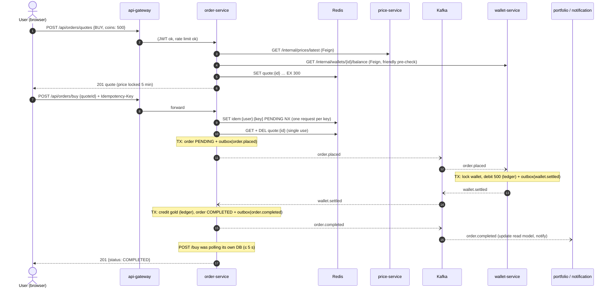
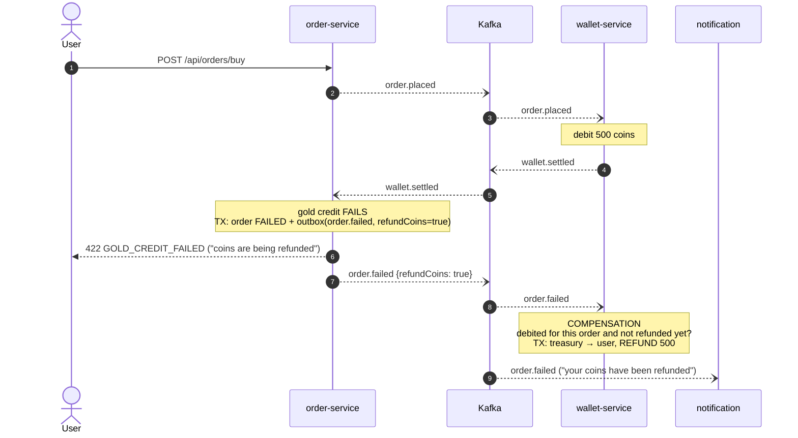
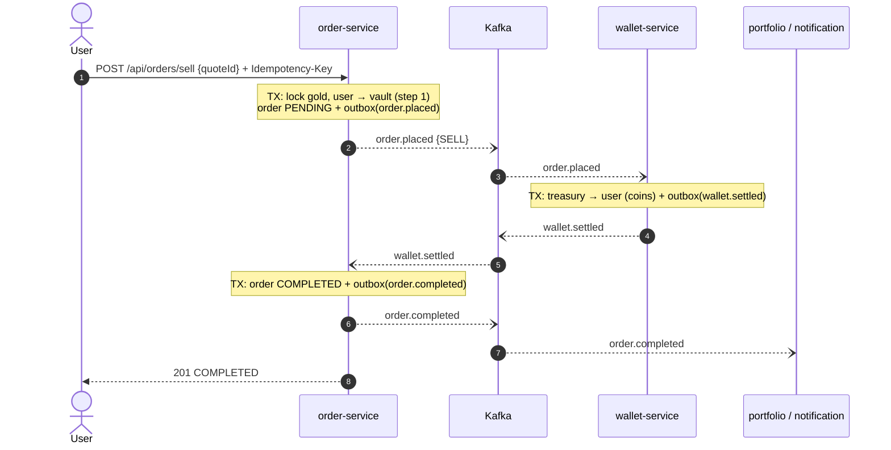
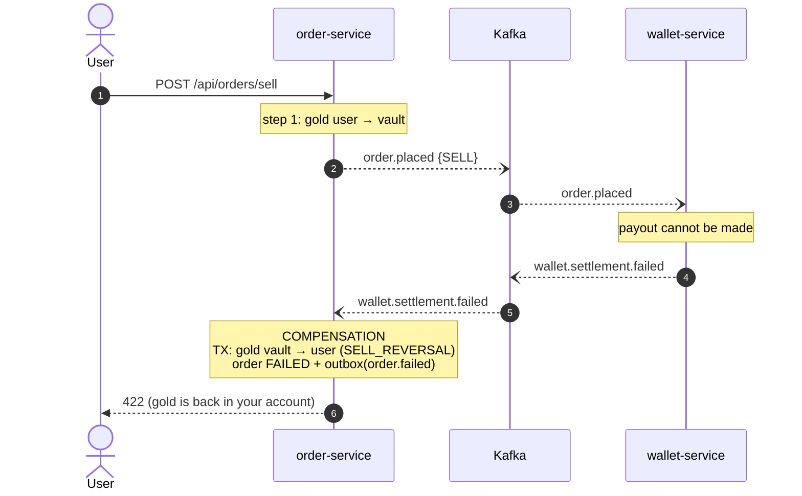
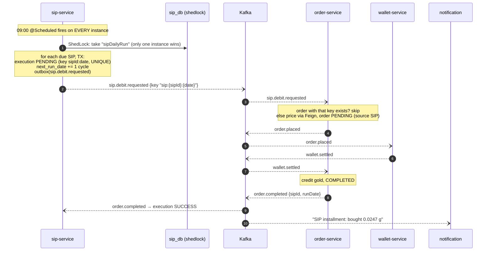
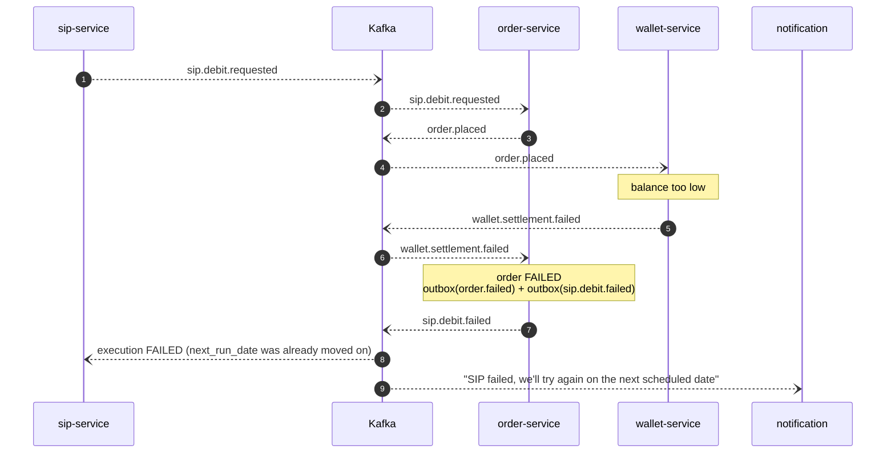

# GoldStack flows (sequence diagrams)

Solid arrows are synchronous HTTP; dashed arrows are Kafka events. Every event a service publishes is first written to
its **outbox** table, in the same database transaction as its change, then relayed to Kafka. Every consumer
**skips events it has already processed** (by event id).

---

## 1. Buy: success



## 2. Buy: not enough coins (the saga stops, nothing to undo)

```mermaid
sequenceDiagram
    autonumber
    actor U as User
    participant O as order-service
    participant K as Kafka
    participant W as wallet-service
    participant N as notification

    U->>O: POST /api/orders/buy (via gateway)
    Note over O: TX: order PENDING + outbox(order.placed)
    O--)K: order.placed
    K--)W: order.placed
    Note over W: balance too low: nothing moves<br/>TX: outbox(wallet.settlement.failed)
    W--)K: wallet.settlement.failed {INSUFFICIENT_BALANCE}
    K--)O: wallet.settlement.failed
    Note over O: TX: order FAILED + outbox(order.failed, refundCoins=false)
    O--)K: order.failed
    K--)W: order.failed (refundCoins=false: no-op)
    K--)N: order.failed ("purchase failed")
    O-->>U: 422 INSUFFICIENT_BALANCE (quote put back; retry needs a NEW key)
```

## 3. Buy: gold credit fails after the coins were taken (COMPENSATION: refund)

Try it: `POST /api/dev/saga/fail-next-gold-credit`, then buy.



## 4. Sell: success



## 5. Sell: payout fails (COMPENSATION: gold returned)



## 6. SIP installment: success



## 7. SIP installment: not enough coins (retry next cycle)


